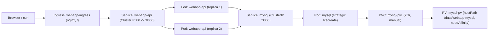

# 🚀 Task Session 2: FastAPI + MySQL with ConfigMap, Secret & Ingress

**Course**: MLOps MENA Community - Kubernetes Course  
**Task Repository Reference**: `MLOpsMENACommunity/Kubernetes-Course-Tasks` (`task-session-2`)  
**Folder**: `Task-2/`  
**Namespace**: `webapp-stack`

---

## 📝 Overview

This task deploys a multi-tier **FastAPI guestbook application** backed by a **MySQL 8.4** database on Kubernetes using:
- **Persistent Storage**: A `2Gi` `hostPath` PersistentVolume (`mysql-pv`, `storageClassName: manual`, `persistentVolumeReclaimPolicy: Retain`) pinned via `nodeAffinity`, bound to `mysql-pvc` in `webapp-stack`.
- **Externalized Configuration**: `ConfigMap` (`webapp-config`) for non-sensitive app/DB settings (`APP_TITLE`, `APP_ENV`, `MYSQL_HOST`, `MYSQL_PORT`, `MYSQL_DATABASE`) and `Secret` (`mysql-secret`) for credentials (`root-password`, `app-user`, `app-password`).
- **Ingress Routing**: An `NGINX` Ingress (`webapp-ingress`) routing `/` to the 2-replica `webapp-api` Service (`80 -> 8000`).
- **Persistence Verification**: Deleting the MySQL Pod and confirming submitted messages survive container restarts.

---

## 🏛️ Architecture



---

## 📁 Folder Contents

| File / Folder | Purpose |
|---------------|---------|
| `webapp/` | Provided FastAPI application & `Dockerfile` (`webapp-api:task2`) |
| `mysql/` | Provided MySQL 8.4 image & `Dockerfile` (`webapp-mysql:task2`) |
| `01-namespace.yaml` | Creates the `webapp-stack` namespace |
| `02-secret.yaml` | Creates `mysql-secret` (`root-password`, `app-user`, `app-password`) |
| `03-configmap.yaml` | Creates `webapp-config` (`APP_TITLE`, `APP_ENV`, `MYSQL_HOST`, `MYSQL_PORT`, `MYSQL_DATABASE`) |
| `04-pv-pvc.yaml` | Creates `mysql-pv` (`2Gi`, `hostPath`, `nodeAffinity`) and `mysql-pvc` |
| `05-mysql.yaml` | Creates `mysql` Deployment (`Recreate`, `1` replica, probes, PVC mount) & `mysql` Service |
| `06-webapp.yaml` | Creates `webapp-api` Deployment (`2` replicas, `envFrom`, `secretKeyRef`, `/health` probes) & `webapp-api` Service |
| `07-ingress.yaml` | Creates `webapp-ingress` (`ingressClassName: nginx`, path `/`, `pathType: Prefix`) |

> **Note on Node Affinity & Windows Docker Builds**:
> - In `04-pv-pvc.yaml`, `nodeAffinity` is set to `k3d-multinodes-agent-1` for the local 3-worker `k3d-multinodes` cluster (update to `minikube-m02` when running on Minikube).
> - On Windows, `mysql/initdb/01-setup.sh` uses LF line endings and `mysql/Dockerfile` runs `chmod -x /docker-entrypoint-initdb.d/01-setup.sh` so the MySQL entrypoint sources the script properly.

---

## 🚀 Deployment Steps

### 1. Build & Load Images

```powershell
docker build -t webapp-api:task2 ./webapp
docker build -t webapp-mysql:task2 ./mysql

# For k3d:
k3d image import -c multinodes webapp-api:task2 webapp-mysql:task2

# Or for Minikube:
# minikube image load webapp-api:task2
# minikube image load webapp-mysql:task2
```

### 2. Apply Manifests in Order

```powershell
kubectl apply -f 01-namespace.yaml
kubectl apply -f 02-secret.yaml
kubectl apply -f 03-configmap.yaml
kubectl apply -f 04-pv-pvc.yaml
kubectl apply -f 05-mysql.yaml
kubectl apply -f 06-webapp.yaml
kubectl apply -f 07-ingress.yaml
```

### 3. Wait for Rollouts

```powershell
kubectl rollout status deploy/mysql -n webapp-stack --timeout=180s
kubectl rollout status deploy/webapp-api -n webapp-stack --timeout=120s
```

### 4. Access via Ingress

```powershell
kubectl port-forward -n ingress-nginx svc/ingress-nginx-controller 8088:80
```

Then open <http://localhost:8088> (or query `/api/info` and `/api/messages`).

---

## 🔍 Verification Results

### 1. PV, PVC, Deployments, Pods, Services & Ingress

```text
kubectl get pv mysql-pv
kubectl get pvc,deploy,pods,svc,ingress -n webapp-stack -o wide
```

- `mysql-pv`: `2Gi`, `RWO`, `Retain`, `Bound` to `webapp-stack/mysql-pvc`, `storageClassName: manual`
- `mysql-pvc`: `Bound` to `mysql-pv`, `2Gi`
- `deploy/mysql`: `1/1`, Pod scheduled on `k3d-multinodes-agent-1`
- `deploy/webapp-api`: `2/2`
- `ingress/webapp-ingress`: `CLASS: nginx`, `ADDRESS` assigned

### 2. Ingress Endpoints (`/api/info` & `/api/messages`)

```powershell
curl.exe -sS http://localhost:8088/api/info
# {"pod":"webapp-api-...","version":"task2","title":"hello in MLOPS MENA COMMUNITY","environment":"dev","db_host":"mysql","db":{"server":"mysql-...","read_only":0}}

curl.exe -sS -X POST http://localhost:8088/api/messages -H "Content-Type: application/json" -d '{\"author\":\"student\",\"content\":\"hello\"}'
# {"id":3,"written_to":"mysql-..."}

curl.exe -sS http://localhost:8088/api/messages
# Returns id 3 ("student": "hello") plus the 2 default messages ("admin", "k8s-labs")
```

### 3. Persistence After MySQL Pod Deletion

```powershell
kubectl delete pod -n webapp-stack -l app=mysql
kubectl rollout status deploy/mysql -n webapp-stack --timeout=120s
curl.exe -sS http://localhost:8088/api/messages
```

After the `mysql` Pod restarted with a new Pod name, `GET /api/messages` still returned `id: 3` (`"author":"student","content":"hello"`) alongside the initial rows, proving data persisted on `mysql-pv` / `mysql-pvc`.

---

## 📸 Screenshots

> Add your screenshots here before pushing to GitHub:
> - `images/ingress-api-info.png` — Ingress access to `/api/info` and `/api/messages`
> - `images/pv-pvc-bound.png` — `kubectl get pv,pvc` showing `Bound` status and `mysql` Pod node
> - `images/persistence-after-restart.png` — `GET /api/messages` after deleting the `mysql` Pod
